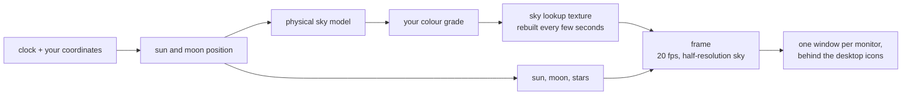

# Day and Night

A live Windows desktop wallpaper that is the sky outside, right now.

The sun rises on your screen when it rises where you are, crosses at the
altitude it really crosses, and sets when it really sets. Twilight is the real
twilight, the moon shows tonight's real phase, and the stars turn about the
celestial pole at the rate they actually turn. The days shorten in autumn
because they are shortening.

There is no video file and no loop. The scene is computed from your clock and
your coordinates, so a 24-hour day costs a few hundred kilobytes of shader and
preset rather than tens of gigabytes of frames - and there is nothing to
repeat, because the sky at 06:12 on a December morning has never been on screen
before.

The look is yours: the application is an editor, and a preset is a small file
you can keep, change and send to someone.

By [Black Canyon Software](https://github.com/BlackCanyonSoftware).

---

## Status

**Milestone 0 is built: a walking skeleton.** The application runs, puts a
live computed sky on the Windows desktop behind the icons on every screen, and
the editor drives it. What it draws is a gradient rather than a sky - the
scattering model, the sun, the moon and the stars arrive in Milestone 1.

One thing is not met: the application costs about 8.5% of one CPU core at its
default settings, against a budget of 2%. That is measured, written up in
[`docs/ARCHITECTURE.md`](docs/ARCHITECTURE.md), and is the open question being
decided before more is built. See [`docs/ROADMAP.md`](docs/ROADMAP.md).

## Quick start

Node 24 (see `.nvmrc`; 22 or newer works).

```bash
npm install
npm run desktop
```

Then set your latitude and longitude under **Place**, and press **Turn the
wallpaper on**.

> `npm run desktop` takes over the desktop background and raises windows.
> `node tools/probe-host.js` checks that the wallpaper technique works on your
> machine without opening anything.

## Scripts

| Script                       | What it does                                             |
| ---------------------------- | -------------------------------------------------------- |
| `npm run desktop`            | Run the application                                      |
| `npm run serve`              | Serve the editor at `http://127.0.0.1:5178`, no Electron |
| `npm run check`              | Lint, format, typecheck, unit and browser tests          |
| `npm run test:unit`          | The arithmetic - astronomy, colour, settings             |
| `npm run test:e2e`           | The editor, in a browser                                 |
| `npm run test:desktop`       | The real application. Opens windows.                     |
| `node tools/probe-host.js`   | Check the WorkerW technique. Opens nothing.              |
| `node tools/measure-cost.js` | Measure what it costs. Opens windows, takes minutes.     |

There is no build step, no database and no environment variables: the file on
disk is the file that runs.

## Project structure

```
app/            the web app, loaded by every window
  engine/       the renderer: no DOM, no Electron, no state between frames
  ui/           the editor
  wallpaper.js  one monitor's surface
desktop/        the Electron shell; host-win32.js is the only Win32 caller
tests/          unit, browser, desktop
docs/           the plan and the reasoning
```

## The documents

| Document                                       | What is in it                                                                 |
| ---------------------------------------------- | ----------------------------------------------------------------------------- |
| [`docs/PRD.md`](docs/PRD.md)                   | What it is and why: users, goals, user stories, scope, the performance budget |
| [`docs/ARCHITECTURE.md`](docs/ARCHITECTURE.md) | How it is built: the stack, the processes, the frame pipeline, the invariants |
| [`docs/DESIGN.md`](docs/DESIGN.md)             | The editor's visual direction, design tokens and components                   |
| [`docs/ROADMAP.md`](docs/ROADMAP.md)           | The milestones, their exit criteria, and what is deliberately not being done  |
| [`docs/adr/`](docs/adr/)                       | The five decisions that shape everything else, and why                        |
| [`docs/HANDOFF.md`](docs/HANDOFF.md)           | Where the work stands and what is next                                        |

## How it works, in one picture



Everything drawn is a pure function of the timestamp, your location and the
preset. Nothing accumulates, which is why the wallpaper is correct after the
machine has slept for six hours, why three monitors stay in step without
talking to each other, and why the editor's preview cannot drift from what is
on the desktop.

## Requirements

Windows 10 1903 or later, and a GPU with working WebGL2.

## Licence

Not yet decided - it is open question OQ-4 in [`docs/PRD.md`](docs/PRD.md), and
is needed before Milestone 2. Third-party notices, when there are any, will go
in `licenses/`.
