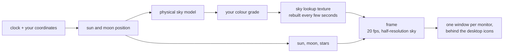

<p align="center">
  <picture>
    <source
      media="(prefers-color-scheme: dark)"
      srcset="docs/brand/lockup/banner/lockup-horizontal-dark-banner.png"
    />
    
  </picture>
</p>

# Day and Night

A live Windows desktop wallpaper that is the sky outside, right now.

The sun rises on your screen when it rises where you are, crosses at the
altitude it really crosses, and sets when it really sets. Twilight is the real
twilight, the moon shows tonight's real phase, and the stars turn about the
celestial pole at the rate they actually turn. The days shorten in autumn
because they are shortening.

There is no video file and no loop. The scene is computed from your clock and
your coordinates, so a 24-hour day costs a few hundred kilobytes of shader and
preset rather than tens of gigabytes of frames - and there is nothing to
repeat, because the sky at 06:12 on a December morning has never been on screen
before.

The look is yours: the application is an editor, and a preset is a small file
you can keep, change and send to someone.

By [Black Canyon Software](https://github.com/BlackCanyonSoftware).

---

## Status

**Not released yet.** Milestones 0 to 2 are done, the clouds and the horizon
are built, and most of what was planned for the editor is in. There is no
download: the licence below is why this is readable rather than usable, and
what is left before a release is listed at the end of this section.

The application runs, puts a sky on the Windows desktop behind the icons on
every screen, and that sky is computed rather than painted: atmospheric
scattering for its colour, real solar and lunar positions, four thousand stars
turning at the sidereal rate, drifting cloud, a procedural horizon, and a grade
on top for haze, colour and contrast. One sky spans a multi-monitor desktop,
each screen drawing the slice it occupies. It knows roughly where you are from
your time zone, and you can search a city or type coordinates.

The editor has a gallery of looks with a picture of each, undo and redo, a
24-hour scrubber painted with the day's real shape, share codes for a look, and
it meets WCAG 2.2 AA - which is to say it was audited, something failed, and
that is now pinned by a test.

**It is cheap to leave running.** 0.15% of one CPU core across two screens
against a budget of 2%, because it redraws only when the picture would actually
differ - a few thousand times a day rather than nearly two million. That number
and how it was taken are in
[`docs/ARCHITECTURE.md`](docs/ARCHITECTURE.md); GPU time is not measured, and
the reason is written down there too.

**What is still missing is listed honestly**, in
[`CHANGELOG.md`](CHANGELOG.md) under Known limitations: the constellations are
generated rather than catalogued, so the sky turns correctly and Orion is not
in it; deep twilight is darker than it should be; the clock shows your time
rather than the chosen place's. Nothing in there is presented as finished.

Before a release: a code-signing certificate, a lawyer's pass over the EULA and
the disclaimer, and four details only the owner can supply - all of them in
[`licenses/README.md`](licenses/README.md). The GPU side of the performance
budget has never been measured, because there is no way to read GPU time on
Windows without a dependency this project will not take; that is written down
rather than glossed.

See [`docs/ROADMAP.md`](docs/ROADMAP.md) for what is next, and its tech-debt
table for what is being left undone on purpose.

## Quick start

Node 24 (see `.nvmrc`; 22 or newer works).

```bash
npm install
npm run desktop
```

Then set your latitude and longitude under **Place**, and press **Turn the
wallpaper on**.

> `npm run desktop` takes over the desktop background and raises windows.
> `node tools/probe-host.js` checks that the wallpaper technique works on your
> machine without opening anything.

## Scripts

| Script                                 | What it does                                                         |
| -------------------------------------- | -------------------------------------------------------------------- |
| `npm run desktop`                      | Run the application                                                  |
| `npm run serve`                        | Serve the editor at `http://127.0.0.1:5178`, no Electron             |
| `npm run check`                        | Lint, format, typecheck, unit and browser tests                      |
| `npm run test:unit`                    | The arithmetic - astronomy, colour, settings                         |
| `npm run test:e2e`                     | The editor, in a browser                                             |
| `npm run test:desktop`                 | The real application. Opens windows.                                 |
| `node tools/probe-host.js`             | Check the WorkerW technique. Opens nothing.                          |
| `node tools/measure-cost.js`           | Decompose the cost by frame rate. Opens windows, ~4 min.             |
| `node tools/measure-cost.js --shipped` | Measure what a user actually leaves running. Opens windows, ~10 min. |

There is no build step, no database and no environment variables: the file on
disk is the file that runs.

## Project structure

```
app/            the web app, loaded by every window
  engine/       the renderer: no DOM, no Electron, no state between frames
  ui/           the editor
  wallpaper.js  one monitor's surface
desktop/        the Electron shell; host-win32.js is the only Win32 caller
tests/          unit, browser, desktop
docs/           the plan and the reasoning
```

## The documents

| Document                                       | What is in it                                                                 |
| ---------------------------------------------- | ----------------------------------------------------------------------------- |
| [`docs/PRD.md`](docs/PRD.md)                   | What it is and why: users, goals, user stories, scope, the performance budget |
| [`docs/ARCHITECTURE.md`](docs/ARCHITECTURE.md) | How it is built: the stack, the processes, the frame pipeline, the invariants |
| [`docs/DESIGN.md`](docs/DESIGN.md)             | The editor's visual direction, design tokens and components                   |
| [`docs/ROADMAP.md`](docs/ROADMAP.md)           | The milestones, their exit criteria, and what is deliberately not being done  |
| [`docs/adr/`](docs/adr/)                       | The seven decisions that shape everything else, and why                       |
| [`docs/HANDOFF.md`](docs/HANDOFF.md)           | Where the work stands and what is next                                        |

## How it works, in one picture



Everything drawn is a pure function of the timestamp, your location and the
preset. Nothing accumulates, which is why the wallpaper is correct after the
machine has slept for six hours, why three monitors stay in step without
talking to each other, and why the editor's preview cannot drift from what is
on the desktop.

## Requirements

Windows 10 1903 or later, and a GPU with working WebGL2.

## Licence

Proprietary. All rights reserved. This repository being visible grants no
licence to copy, modify or use it - the terms are in
[`LICENSE`](LICENSE) and [`licenses/SOURCE-LICENSE.md`](licenses/SOURCE-LICENSE.md).

A released build is licensed to the person who installs it under
[`licenses/EULA.md`](licenses/EULA.md), with the disclaimers, the privacy notice
and the third-party notices beside it. [`licenses/README.md`](licenses/README.md)
says which document applies where, and what is still to be filled in before a
release. [ADR 0006](docs/adr/0006-proprietary-licence-and-nsis-installer.md)
records the decision.

## Building the installer

```
npm run build
```

Writes a Windows installer to `dist/`. It carries the brand's own icon at
every size Windows asks for, and it is unsigned unless `CSC_LINK` and
`CSC_KEY_PASSWORD` are in the environment - so a build made today is for a test
machine, not for release: an unsigned installer earns a SmartScreen warning,
which on a wallpaper that asks to start at login is the difference between a
download and an uninstall.

Then check that the build actually works, which is a different question from
whether it built:

```
node tools/verify-package.js
```

It launches `dist/win-unpacked`, which needs no installing, and confirms the
editor opens from the custom scheme, the engine renders, and a sky reaches the
real desktop - which is the only way to know that koffi's native binary loads
from outside the asar archive. **It briefly replaces your desktop background.**
