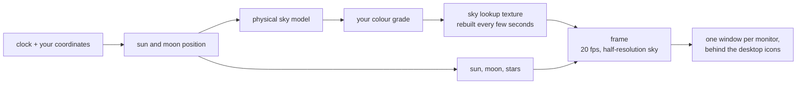

# Day and Night

A live Windows desktop wallpaper that is the sky outside, right now.

The sun rises on your screen when it rises where you are, crosses at the
altitude it really crosses, and sets when it really sets. Twilight is the real
twilight, the moon shows tonight's real phase, and the stars turn about the
celestial pole at the rate they actually turn. The days shorten in autumn
because they are shortening.

There is no video file and no loop. The scene is computed from your clock and
your coordinates, so a 24-hour day costs a few hundred kilobytes of shader and
preset rather than tens of gigabytes of frames - and there is nothing to
repeat, because the sky at 06:12 on a December morning has never been on screen
before.

The look is yours: the application is an editor, and a preset is a small file
you can keep, change and send to someone.

By [Black Canyon Software](https://github.com/BlackCanyonSoftware).

---

## Status

**Planning. There is no code yet.** This repository currently holds the plan
only. The quick start, scripts, screenshots and project structure arrive with
Milestone 0; see `docs/ROADMAP.md` for what that includes and
`docs/HANDOFF.md` for exactly where things stand.

## The documents

| Document | What is in it |
|---|---|
| [`docs/PRD.md`](docs/PRD.md) | What it is and why: users, goals, user stories, scope, the performance budget |
| [`docs/ARCHITECTURE.md`](docs/ARCHITECTURE.md) | How it is built: the stack, the processes, the frame pipeline, the invariants |
| [`docs/DESIGN.md`](docs/DESIGN.md) | The editor's visual direction, design tokens and components |
| [`docs/ROADMAP.md`](docs/ROADMAP.md) | The milestones, their exit criteria, and what is deliberately not being done |
| [`docs/adr/`](docs/adr/) | The five decisions that shape everything else, and why |
| [`docs/HANDOFF.md`](docs/HANDOFF.md) | Where the work stands and what is next |

## How it works, in one picture

Everything drawn is a pure function of the timestamp, your location and the
preset. Nothing accumulates, which is why the wallpaper is correct after the
machine has slept for six hours, why three monitors stay in step without
talking to each other, and why the editor's preview cannot drift from what is
on the desktop.

## Requirements

Windows 10 1903 or later, and a GPU with working WebGL2.

## Licence

Not yet decided - it is open question OQ-4 in [`docs/PRD.md`](docs/PRD.md), and
is needed before Milestone 2. Third-party notices, when there are any, will go
in `licenses/`.
