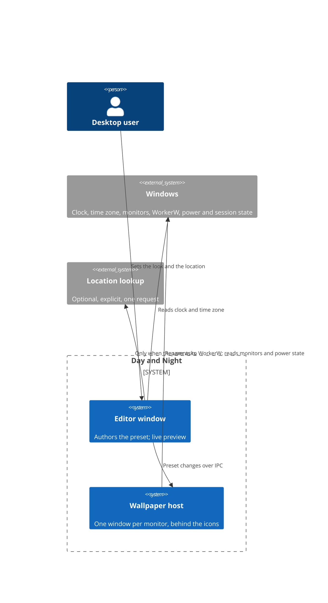
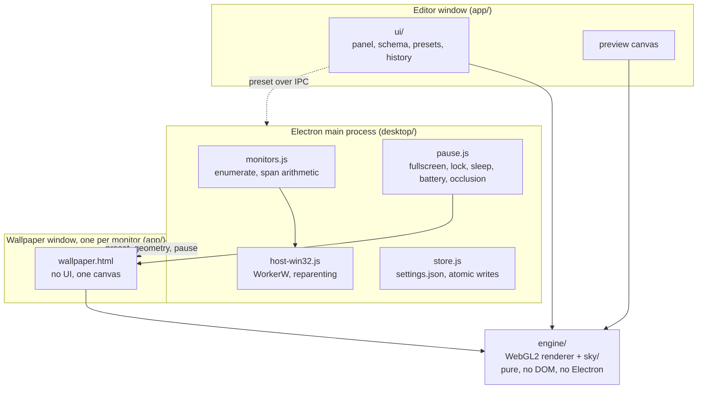
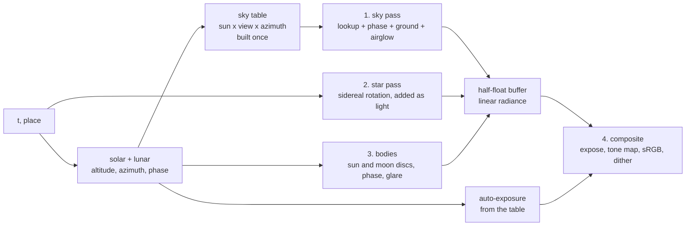

# Architecture

What Day and Night is made of, why it is shaped that way, and the rules that
do not bend. Read this before changing anything under `app/` or `desktop/`.

## In one paragraph

Day and Night is an Electron application wrapped around a static web app with
no build step. One Electron main process owns the machine: it enumerates
monitors, parents a borderless window to the Windows `WorkerW` so that window
draws behind the desktop icons, watches the power and session state, and holds
the settings file. The scene itself is a WebGL2 renderer (`app/engine/`) that
knows nothing about Electron, the DOM or the desktop: it is handed a preset, a
timestamp, a location and a crop rectangle, and it draws one frame. Everything
in that frame - where the sun is, how red the horizon is, which stars are up,
how far the clouds have drifted - is computed from those four inputs and
nothing else. There is no accumulated state anywhere in the renderer, which is
why a wallpaper window can be destroyed at noon and recreated at dusk and be
exactly right, why three monitors stay in lockstep without talking to each
other, and why the editor's time scrubber and the live wallpaper run the same
code path. That property is the product.

## Stack and rationale

| Layer       | Choice                                                      | Why, and what was rejected                                                                                                                                                                                                                                         |
| ----------- | ----------------------------------------------------------- | ------------------------------------------------------------------------------------------------------------------------------------------------------------------------------------------------------------------------------------------------------------------ |
| Shell       | **Electron 33+**                                            | Same shell as Pixel Galaxy Studio, so the editor UI ports across and the owner maintains one pattern. A system WebView2 was rejected: no reliable control over the swap chain, and the WorkerW reparenting story is worse. ADR 0001.                               |
| Renderer    | **WebGL2** (GLSL ES 3.0)                                    | Universally present in Electron's Chromium, mature drivers, and a 24/7 process is the wrong place to be first to a new graphics API. WebGPU was rejected for now and is a drop-in upgrade later; the engine's host interface is drawn so that it can be. ADR 0003. |
| Language    | **JavaScript, ES modules, no build step**                   | Matches Pixel Galaxy Studio. Type safety comes from `// @ts-check` with `checkJs` and `strict` on from day one (which PGS is retrofitting; this project does not get that debt). A bundler buys nothing here and costs a build.                                    |
| Win32 calls | **koffi** FFI, behind one module                            | Four or five calls are needed (`FindWindowW`, `SendMessageTimeoutW`, `EnumWindows`, `SetParent`, `SHQueryUserNotificationState`). A hand-written N-API addon is the alternative and stays documented. ADR 0002.                                                    |
| Tests       | **node:test** units, **Playwright** browser and image tests | What PGS uses. The solar arithmetic is pure and gets the tightest unit tests in the project.                                                                                                                                                                       |
| Settings    | **JSON file in the OS app-data folder**, written atomically | Same shape and migration table as PGS: `{ app, version, savedAt, cfg, ui }`.                                                                                                                                                                                       |

## Context



## Containers



The editor and every wallpaper window import the **same** `engine/`. Nothing in
`engine/` can tell which it is running in.

## Layout

```
app/                      the web app; everything a window loads
  index.html              the editor: panel, stage, guide, preview
  wallpaper.html          one monitor's surface: a canvas and nothing else
  styles.css              the editor's stylesheet, sectioned
  tokens.css              design tokens only; light and dark (see DESIGN.md)
  engine/                 the renderer. No DOM, no Electron, no timers, no state between frames
    index.js              assembles the Engine; the public surface
    astro/
      julian.js           civil time to Julian day; UT against TT; the degree-based trig
      coords.js           obliquity, nutation, the three frames and the transforms between them
      solar.js            the Sun: ecliptic position, altitude, azimuth, equation of time
      lunar.js            the Moon: position, distance, phase, illuminated fraction, limb angle
      sidereal.js         Greenwich and local sidereal time; the star field's rotation
    sky/
      atmosphere.js       the physical sky: Rayleigh, Mie and ozone, integrated
      lut.js              the baked table, shared; auto-exposure; CPU sampling
      oklab.js            sRGB <-> linear <-> Oklab; the only colour space conversions
    bodies.js             sun and moon discs, bloom, lunar phase mask
    stars.js              the star field: the catalogue and its vertex buffer
    dither.js             blue-noise output dither
    gl/
      context.js          context creation, loss and restore
      program.js          shader compilation and uniform plumbing
      texture.js          the sky table as a 3D texture
    frame.js              one frame: the whole pipeline for (preset, t, place, crop)
    types.js              JSDoc typedefs for everything that crosses a seam
  ui/                     the editor, as ES modules
    index.js              boot, the page API, the wiring
    state.js              cfg, ui, the setters; no module holds a stale copy
    schema.js             the panel as data: sections of rows, every row with a hint
    panel.js              draws the panel from the schema
    presets.js            the bundled looks
    place.js              location: time-zone guess, city picker, manual entry, lookup
    clock.js              the editor's time: real, scrubbed, or fast-forwarded
    monitors.js           the monitor layout panel and its drag
    output.js             span arithmetic, per-monitor crop rectangles
    settings.js           settings documents, versions, migrations, save and load
    history.js            undo and redo
    preview.js            the preview loop, scale and scope
    theme.js              light and dark; the sun/moon toggle
    guide.js  faq.js      the guide and its questions
    desktop.js            the shell when there is one; the browser's way when there is not
    util.js               $, el, clamp, formatting, the modal, the info dot
  brand/                  the mark and wordmarks. EMPTY until the owner supplies them
desktop/                  the Electron shell
  main.js                 app lifecycle, the custom scheme, window creation
  monitors.js             enumeration and change events
  host-win32.js           WorkerW discovery and reparenting; the only FFI caller
  pause.js                the pause policy and its signals
  store.js                settings.json, atomic and debounced
  preload.js              the one bridge: contextIsolation on, no node in the renderer
  about.html/.css/.js     the About window
tools/                    run occasionally, never at run time
tests/
  unit/                   node:test; the astro arithmetic above all
  browser/                Playwright; the editor and its states
  image/                  Playwright screenshots; the sky at fixed instants
docs/                     this folder
licenses/                 every legal document; copied into every released build
```

## The engine

`engine/index.js` exposes one class with a deliberately small surface:

```js
const engine = new DayNightEngine(gl);
engine.setPreset(preset); // the authored look
engine.render({ t, place, crop, pixelRatio }); // one frame
```

- **`t`** a millisecond UTC timestamp. Not "now" - the caller decides, which is
  what makes the editor's scrubber and the live wallpaper the same code.
- **`place`** `{ lat, lon }` in degrees.
- **`crop`** this surface's rectangle within the span, in span pixels. The
  editor's preview passes the whole span; a wallpaper window passes its monitor.
- **`pixelRatio`** that monitor's scaling, so one preset looks the same size on
  a 1080p screen and a 4K one next to it.

Nothing else. No `start`, no `stop`, no `tick`. The host decides when a frame is
wanted; the engine has no opinion about time passing.

### The frame pipeline



**Four passes, summed before tone mapping.** The sky, the stars and the bodies write
linear radiance into a half-float buffer, and the whole sum is tone mapped
once on the way to the screen. This is not an optimisation, it is what makes
the stars behave: a star drawn over an already tone-mapped sky could never be
dimmer than the sky under it, so stars would still be visible at noon. Added
as light, in the same units as the sky, they are simply outshone - and they
emerge through twilight in order of brightness without a rule being written
for it.

Two timescales, deliberately separated. The **scattering table**
(`sky/atmosphere.js`) is the expensive part - a ray-marched integration
through the atmosphere - and it is built **once per process**, because sun
elevation is one of its axes rather than an input to it. The **frame** is then
a single texture fetch, two phase functions and a tone map.

That split is where the performance budget is won twice over: the physically
modelled part never runs again after start-up, and the per-frame part is
cheap enough that the thing limiting cost is how often a frame is presented at
all - which is what `signature.js` decides.

The table is three-dimensional, and the reason is in `sky/atmosphere.js`: the
phase functions factor out of the integral and are applied per pixel, but the
geometry inside it genuinely depends on the azimuth between the view and the
sun. That was measured rather than assumed. At civil twilight the sky opposite
the sun is five hundred times dimmer than the sky above it.

**Auto-exposure** is part of the pipeline rather than a setting. The sky spans
roughly six thousand to one between noon and civil twilight and several more
orders of magnitude below that, so no fixed exposure can show both ends. The
bake emits a reference brightness per sun elevation and the renderer exposes
towards a mid-grey, capped at the dark end so the night stays night instead of
becoming amplified noise. The user's own exposure control is an offset on top,
in stops.

### Colour

Light is summed in **linear** space, always. Colour is interpolated in
**Oklab**, never sRGB, because Oklab's lightness axis matches perception: a
ramp interpolated there steps evenly to the eye, where an sRGB component lerp
bends lightness through the gamma curve and reads as pinched. Across a wide,
shallow gradient that is the most visible difference between this looking
professional and looking cheap.

Oklab is _not_, however, a cure for interpolating between complementary hues -
orange to deep blue desaturates through the middle in Oklab much as it does in
sRGB, because the straight line between opposing chroma vectors passes near the
neutral axis. Avoiding that is the ramp's job, not the colour space's: the
authored stops trace the real hue path, so neighbouring stops are close in hue.
This was found by a unit test that originally asserted the opposite, and both
properties are now pinned in `tests/unit/oklab.test.mjs`.

The conversions live only in `sky/oklab.js`; no other module converts a colour.
Output is tone-mapped once, converted to sRGB once, and dithered with blue
noise so that a 30-degree gradient across 2560 pixels does not band.

## Processes and windows

- **Main process.** Owns everything that touches the machine. Creates windows,
  enumerates monitors, performs the reparenting, watches power and session
  state, reads and writes the settings file. The only process with Node access.
- **Editor window.** An ordinary Electron window. Hidden rather than destroyed
  when closed, so reopening is instant and the wallpaper never restarts.
- **Wallpaper windows.** One borderless, transparent-capable, focusable-false
  window per enabled monitor, each parented to `WorkerW`, each loading
  `wallpaper.html` with its own crop rectangle. One window per monitor rather
  than one window spanning them all, because per-monitor DPI on a single
  oversized window is a long-standing Chromium headache, and because a monitor
  that is unplugged should take its window with it and nothing else.

The windows do not synchronise. They cannot drift, because each one computes
the scene from the same wall clock through the same pure function. This is
worth stating plainly because the instinct is to add a sync channel, and adding
one would be the bug.

### The custom scheme

`app/` is served from the application's own scheme (`dayandnight://app/`),
registered as a standard secure origin, exactly as Pixel Galaxy Studio serves
`pgs://app/`. `file://` is not a secure context and would cost module workers
and a well-behaved WebGL context. No local HTTP server ships.

### The bridge

`contextIsolation: true`, `nodeIntegration: false`, `sandbox: true`. `preload.js`
exposes one frozen object with a named function per operation - no generic
"invoke anything" channel, no `ipcRenderer` in the renderer. Every message from a
renderer is validated in the main process against a schema before it is acted
on, because a renderer is the less trusted side even when we wrote it.

## The host

Making a window draw behind the desktop icons on Windows:

1. `FindWindowW("Progman", null)` - the Explorer desktop window.
2. `SendMessageTimeoutW(progman, 0x052C, ...)` - asks Explorer to spawn a
   `WorkerW` behind the icon layer.
3. `EnumWindows` for the `WorkerW` that has **no** `SHELLDLL_DefView` child.
   That one is behind the icons; the other is in front of them.
4. `SetParent(ourWindow, thatWorkerW)`.

All four live in `desktop/host-win32.js` and nowhere else. If step 3 finds
nothing - a future Windows build, a replacement shell, Explorer not running -
the module reports failure and the host falls back to a bottom-most
desktop-level window, which covers the wallpaper but keeps the product working
and visible. The fallback is a documented degraded mode, not a silent one: the
editor says which mode is active.

## Monitors and the span

The **span** is the bounding rectangle of every enabled monitor in
virtual-desktop coordinates. The scene is composed for the span, and each
monitor's window renders the sub-rectangle it occupies. The sun's azimuth maps
across the full span, so on a three-monitor row the sun genuinely travels from
the left screen to the right over the day.

Monitors at different scale factors each get their own `pixelRatio`, so
features keep their apparent size rather than their pixel size. Gaps in the
arrangement - an L-shaped layout - are part of the span and simply are not
rendered; the scene behaves as though the missing region existed, because
otherwise the sun would jump as it crossed the gap.

The layout arithmetic is ported from Pixel Galaxy Studio's `ui/output.js`,
which has already met mixed DPI, rotation, vertical stacks and negative
coordinates.

## The pause policy

A 24/7 process earns its place by not running. `desktop/pause.js` holds every
signal; the wallpaper windows render only when it says to.

| Signal                                  | Source                         | Action                 |
| --------------------------------------- | ------------------------------ | ---------------------- |
| Full-screen or exclusive application    | `SHQueryUserNotificationState` | Stop                   |
| Session locked or switched              | Electron `powerMonitor`        | Stop                   |
| Display powered down, system suspending | `powerMonitor`                 | Stop                   |
| On battery (configurable, default stop) | `powerMonitor`                 | Stop or reduce         |
| Desktop fully occluded by windows       | Window visibility              | Stop                   |
| Editor preview not visible              | Window state                   | Stop that preview only |

"Stop" means no frames and the render loop torn down, not a loop that runs and
returns early. Resume is a fresh `render()` at the current timestamp, which is
correct by construction - there is no state to restore.

## Cross-cutting

- **Configuration.** No environment variables at run time; the settings file is
  the configuration, validated against the schema on read, and a file that fails
  validation is renamed aside rather than deleted, with defaults loaded and the
  user told.
- **Errors.** A shader that fails to compile, a lost GL context, a missing
  `WorkerW`: each is reported to the editor as a named condition with a
  sentence the user can act on. Nothing is swallowed. A lost context is
  recreated and the frame re-rendered; nothing else needs to know, because
  there is no state to lose.
- **Logging.** Structured lines to stdout in development. In a packaged build,
  a ring buffer the user can save as a report from the About window - the same
  pattern as Pixel Galaxy Studio. Never a log file growing silently for a month.
- **Security model.** No server, no accounts, no personal data beyond a
  latitude and longitude the user typed. The threats that apply are local: an
  untrusted preset file (validated against a schema, and it carries data only,
  never code), an untrusted user PNG for a later horizon layer (decoded in the
  renderer, never as a path handed to anything), and the renderer-to-main
  boundary (named channels, validated payloads). The security baseline in
  `AGENTS.md` still applies in full; most of it is simply not reachable here,
  and that is itself worth keeping true.

## Invariants

These are the rules a change must not break. They are checked in review and,
where a test can, in the suite.

1. **The scene is a pure function of `(preset, t, place, crop, pixelRatio)`.**
   No accumulated state, no `Date.now()` inside the engine, no timers, no
   random number that is not seeded from those inputs. Two calls with the same
   arguments produce identical pixels.
2. **The engine never touches the DOM, Electron, or the network**, and never
   decides when to draw.
3. **Every window computes the scene independently.** No synchronisation
   channel between wallpaper windows, ever.
4. **Colour is mixed in linear light and interpolated in Oklab**, and the
   conversions live only in `sky/oklab.js`.
5. **No setting can make the sun wrong.** Astronomical position is not
   user-facing; only the look is. A preset describes appearance, never geometry.
6. **A new setting is a default with a comment, a schema row with a hint, and a
   migration entry if it renames or changes the meaning of an existing key.**
7. **Pausing is tearing down the loop**, not skipping work inside it.
8. **`desktop/host-win32.js` is the only module that calls Win32.**

## Performance

The budget is NFR-1 in the PRD. Where it is spent, by design:

- The scattering table, the only physically-expensive work, is built once per
  process rather than per frame, because sun elevation is one of its axes.
  About 780 ms at start-up for a 288 KB table.
- A frame is one 3D texture fetch, two phase functions and a tone map.
- Default 20 fps, user-settable from 10 to 30. The goal is never stuttering
  while the user works, not a high frame rate. Clouds, when they arrive, are
  the only layer that would argue for more.
- The star catalogue is a static vertex buffer uploaded once. Glow and pulse
  are per-vertex functions of `t` and a per-star hash, so animating them costs
  nothing on the CPU.

Measured numbers go in this section as they are taken, with the machine and the
method. An unmeasured claim does not belong here.

### Measurement, Milestone 0 (2026-10-18)

**The budget is not met.** This is the open question Milestone 0 existed to
answer, and the answer is uncomfortable.

Machine: AMD Ryzen 5 3600 (6 cores, 12 threads), Windows 10, two screens,
WorkerW host attached, editor window hidden. Taken by `tools/measure-cost.js`,
which reads processor-seconds for every process of the application from the OS
and divides by wall time. CPU is quoted as a percentage of **one core**,
because that is the honest unit for a background task - the same figures are
twelve times smaller against the whole machine, which would flatter them.

| Scenario                               | CPU (% of one core) | Memory     | Processes |
| -------------------------------------- | ------------------- | ---------- | --------- |
| Wallpaper off, nothing drawing         | 4.54                | 360 MB     | 4         |
| Wallpaper on, 30 fps                   | 11.36               | 568 MB     | 6         |
| **Wallpaper on, 20 fps (the default)** | **8.56**            | **580 MB** | 6         |
| Wallpaper on, 10 fps                   | 5.50                | 589 MB     | 6         |
| Wallpaper on, 5 fps                    | 2.46                | 592 MB     | 6         |
| Wallpaper on, 1 fps                    | 4.97                | 596 MB     | 6         |

Against NFR-1's "under 2 per cent of one core, under 80 MB per screen": the
default costs **4.3 times the CPU budget** and roughly **3.5 times the memory
budget**, and ADR 0001's own estimate of 150-250 MB resident was optimistic by
more than a factor of two.

> Superseded by the Milestone 1 measurement below, which met the CPU budget.
> This section is kept because it is the reason the frame-skipping exists, and
> because two of its rows were contaminated and one of its assumptions was
> wrong - both of which the later section explains.

**What is solid and what is not.** The 10, 20 and 30 fps rows are consistent
and give a clean slope of about **0.29 % of one core per frame per second**
across two screens, or roughly 0.15 % per fps per screen. The 1 fps row (4.97)
sits above the 5 fps row (2.46), and the idle row (4.54) sits above 5 fps as
well; both are impossible, so those two samples are contaminated - most likely
by start-up work inside the settling window and by other activity on the
machine. **The floor has therefore not been measured reliably** and the
decomposition into "floor plus per-frame" is not yet trustworthy. The headline

- well over budget at the intended default - does not depend on those two rows.

**What this does and does not implicate.** It is not the sky: the Milestone 0
fragment shader is a vertical gradient with a dither, a handful of instructions
per pixel. The cost is Chromium presenting a frame per surface per tick, plus
whatever the floor turns out to be, and neither gets cheaper by drawing a
simpler sky. Drawing _less often_ does scale it, which is why 5 fps nearly
reaches the budget - but Milestone 3's clouds are the layer that needs frames,
so a low frame rate buys time rather than solving the problem.

This reopens ADR 0001 exactly as that decision said it would, and it does so at
the moment the decision intended: before any art has been built on the
assumption. The options are recorded in `docs/ROADMAP.md` under tech debt;
nothing further should be built on the Electron host until the owner has
chosen between lowering the frame rate, redrawing only when the scene has
meaningfully changed, moving the surfaces to a native host, or revising the
budget.

GPU time was **not measured**: there is no dependency-free way to read it on
Windows, and a figure derived from a frame counter would not be a measurement.

### Drawing only when the picture changes

The owner's answer to the above was to stop redrawing frames that are
identical, which is the first option in the roadmap's list.

`engine/signature.js` builds a value from everything the fragment shader
reads - the two gradient colours after exposure, quantised to the 8 bits a
display can actually show, plus the gradient's shape and the geometry. The
host keeps the last signature and presents a frame only when it changes. The
engine itself remembers nothing, so invariants 1 and 2 both hold: the
signature is a pure function, and the _host_ still decides when to draw.

Comparing colours rather than elapsed time or a rounded sun altitude avoids
choosing a threshold, which would have to be wrong somewhere - the sky changes
far faster at sunrise than at noon. This is exactly as sensitive as the display
is, and it follows the sky's own pace: nearly static through the night, every
frame through sunrise. Because consecutive drawn frames differ by at most one
quantisation step, "redraws rarely" and "looks continuous" are the same
statement rather than a trade-off.

Over 21 June at Denver, sampled at 20 fps:

|                          |           |
| ------------------------ | --------- |
| Ticks in a day at 20 fps | 1,728,000 |
| Frames actually drawn    | 5,432     |
| Reduction                | 99.7 %    |
| Average draws per second | 0.06      |

### Measurement, Milestone 1 (2026-10-19)

**The budget is met, with an order of magnitude to spare.** The configuration a
user leaves running costs **0.15 % of one core** against a budget of 2 %.

Same machine as before: AMD Ryzen 5 3600 (6 cores, 12 threads), Windows 10, two
screens, WorkerW host attached, default preset, 20 fps. Taken by
`node tools/measure-cost.js --shipped`: five windows of 60 seconds per scenario
after 12 seconds of settling, the median reported and the spread reported beside
it so a figure cannot hide its own noise.

| Scenario                           | CPU (% of one core) | Spread | Working set | Processes |
| ---------------------------------- | ------------------- | ------ | ----------- | --------- |
| Milestone 0, 20 fps, editor hidden | 8.56                | -      | 580 MB      | 6         |
| 20 fps, editor hidden              | 1.97                | 1.36   | 761 MB      | 6         |
| **Shipped: 20 fps, editor closed** | **0.15**            | 0.13   | 488 MB      | 5         |

The shipped row's five windows were 0.18, 0.18, 0.15, 0.05 and 0.08, so the
whole band is inside the budget rather than only its middle.

**Two things changed since Milestone 0, and the middle row separates them.**

- **Skipping identical frames took 8.56 % to 1.97 %**, a factor of 4.3, with the
  editor hidden in both cases so that nothing else moved. That saving of 6.6
  points is the per-frame component disappearing: Milestone 0 measured the slope
  at about 0.29 % per fps across two screens, which puts the per-frame cost at
  the default near 5.8 points, and the two agree inside the noise of the older
  run. The frame-rate sweep corroborates it from the other direction - 30, 20,
  10, 5 and 1 fps now all land between 1.6 and 3.4 where Milestone 0 had 11.4
  falling to 2.5. The slope has collapsed, which is exactly what skipping
  predicts and what no other explanation does.
- **Closing the editor took 1.97 % to 0.15 %**, which is 1.82 points, or 92 % of
  everything that was left. The editor is not drawing while it is hidden - the
  preview loop tears down on `visibilitychange` - so this is Chromium holding a
  second renderer and its WebGL context alive, not a loop still running. It is
  also 273 MB of the working set.

**The Milestone 0 sweep was measuring the wrong thing**, which is worth stating
plainly because it is the kind of error that survives in a document for years.
Every row of that table was taken with the editor _hidden_, and a hidden editor
is a window nobody leaves open for a day. The sweep therefore charged the
product 1.8 points for something that is not part of it, on top of whatever the
sky cost. `--shipped` exists to measure the thing itself.

Three other method changes, all of them things the earlier run got wrong:

1. **Windows of 60 seconds, not 6.** At 2 % of one core a six-second window
   holds about a tenth of a processor-second of signal, which is the same size
   as the machine's own background activity. The first re-measurement attempt
   returned five scenarios that were statistically indistinguishable and a
   self-check that correctly refused to report any of them.
2. **"Below idle is impossible" is no longer true.** It was the right check when
   drawing cost something; once identical frames are skipped, a scenario that
   draws genuinely costs what the floor costs, so the tolerance now comes from
   the two scenarios' own spreads rather than from a fixed 0.2.
3. **That check is off in `--shipped` mode entirely**, because the first row
   there is not a floor - it is the hidden-editor scenario, which is _supposed_
   to cost more than the second.

**What this settles.** ADR 0001 stands. The host decision reopened when the
budget failed at Milestone 0, exactly as that ADR said it would, and it closes
here: Electron holds a 24/7 wallpaper inside the budget by a factor of 13, and
it does so without lowering the frame rate, which keeps Milestone 3's clouds
affordable. The native host in ADR 0001's option 2 remains possible and is no
longer needed.

**What is still not measured or not met.**

- **GPU time: not measured**, unchanged. There is no dependency-free way to read
  it on Windows and a figure derived from a frame counter would not be a
  measurement.
- **Memory is not the budgeted quantity.** NFR-1 asks for under 80 MB of _GPU_
  memory per screen; this tool reads working set, so that line of the budget is
  unverified rather than met. The 488 MB of working set across the shell and two
  surfaces is still roughly double ADR 0001's 150-250 MB estimate, which was
  optimistic and should be read as such.
- **Three screens, not two.** Milestone 2 re-measures with three active, which
  is where the per-surface component shows up properly.

### Drawing only when the picture changes
